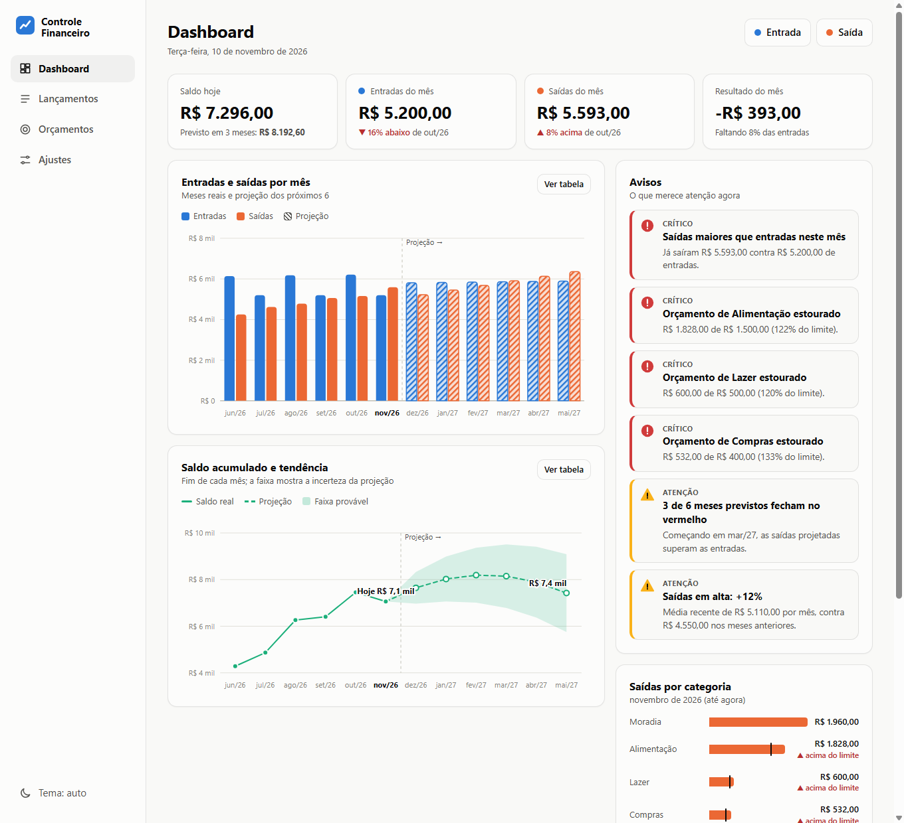

# Controle Financeiro

Aplicação web para controlar entradas e saídas de dinheiro. A tela inicial é um dashboard com gráficos, avisos e a projeção dos próximos meses, calculada a partir do que você já lançou.

O acesso é por usuário e senha. Cada usuário tem o próprio dashboard e os próprios dados, guardados no [Supabase](https://supabase.com). Um administrador cria as contas. O site em si é estático (HTML, CSS e JavaScript), sem etapa de build.



## Sumário

- [Funcionalidades](#funcionalidades)
- [Como usar](#como-usar)
- [Contas e dados (Supabase)](#contas-e-dados-supabase)
- [Planilhas XLSX](#planilhas-xlsx)
- [Como a projeção funciona](#como-a-projeção-funciona)
- [Privacidade e dados](#privacidade-e-dados)
- [Tecnologias](#tecnologias)
- [Estrutura do projeto](#estrutura-do-projeto)
- [Requisitos](#requisitos)
- [Limitações conhecidas](#limitações-conhecidas)
- [Licença](#licença)

## Funcionalidades

- **Login por usuário e senha:** cada pessoa vê só os próprios lançamentos, orçamentos e dashboard.
- **Administração de usuários:** o administrador cria contas, redefine senhas, desativa, reativa, promove e exclui usuários. Qualquer usuário pode trocar a própria senha.
- **Lançamento de valores:** formulário com tipo (entrada ou saída), descrição, valor, data e categoria. Dá para marcar o lançamento como mensal (salário, aluguel, assinaturas) para que ele se repita automaticamente.
- **Dashboard:**
  - saldo de hoje, entradas, saídas e resultado do mês, com comparação ao mês anterior;
  - gráfico de barras de entradas e saídas por mês, com os próximos 6 meses projetados;
  - gráfico de saldo acumulado com projeção tracejada e faixa de incerteza;
  - saídas do mês por categoria, com o limite de orçamento marcado;
  - tendências: saldo previsto em 3 e 6 meses e médias previstas de entradas e saídas.
- **Avisos:** alertas classificados como Crítico, Atenção, Positivo e Info. Exemplos: saldo previsto negativo, saídas maiores que as entradas, saídas em alta, orçamento estourado e categoria fora do seu padrão.
- **Lançamentos:** lista filtrável por mês, tipo e texto, com edição, exclusão e opção de desfazer.
- **Orçamentos:** limite mensal por categoria de saída, com barra de progresso. O aviso aparece ao passar de 80%.
- **Planilhas XLSX:** exporta tudo para uma planilha e importa lançamentos de uma planilha preenchida no Excel.
- **Backup e exportação:** backup em JSON e exportação em CSV.
- **Tema claro e escuro**, automático ou escolhido por você.
- **Layout responsivo**, para computador e celular.
- **Acessibilidade:** os gráficos têm legenda, tooltips e uma visão em tabela, e os avisos usam ícone e texto além da cor.

## Como usar

### Abrir o site

Antes do primeiro uso, configure o Supabase (veja [Contas e dados](#contas-e-dados-supabase)). Não há instalação nem build. Duas opções:

1. Dê duplo clique em `index.html`.
2. Ou sirva a pasta por HTTP, se preferir:

   ```bash
   python -m http.server 8000
   ```

   Depois acesse <http://localhost:8000>.

### Primeiros passos

1. Entre com o usuário e a senha que o administrador criou para você.
2. Clique em **Entrada** ou **Saída** no topo da tela e preencha o formulário.
3. Se o valor se repete todo mês, marque **Repete todo mês**.
4. Em **Ajustes**, informe o **saldo inicial**, isto é, quanto você tinha antes do primeiro lançamento.
5. Em **Orçamentos**, defina limites por categoria, se quiser receber avisos de gasto.
6. Volte ao **Dashboard** para ver gráficos, avisos e tendências.

Para conhecer a aplicação sem digitar nada, clique em **Carregar dados de exemplo** na tela inicial vazia ou em **Ajustes**. Isso substitui os dados atuais.

## Contas e dados (Supabase)

Os usuários e os dados ficam num projeto Supabase seu. O passo a passo abaixo leva uns 10 minutos e é feito uma única vez.

1. **Crie as tabelas.** No painel do Supabase, abra **SQL Editor**, cole todo o conteúdo de [supabase/001_schema.sql](supabase/001_schema.sql) e clique em **Run**. O script pode ser executado de novo sem problema.
2. **Crie o primeiro administrador.**
   1. Vá em **Authentication > Users > Add user > Create new user**.
   2. Use o e-mail `admin@usuarios.controle-financeiro.app`, uma senha forte e marque **Auto Confirm User**.
   3. No **SQL Editor**, rode [supabase/002_admin.sql](supabase/002_admin.sql). Ele marca essa conta como administradora. A senha não passa por nenhum arquivo do projeto.
3. **Publique a função de administração.** Em **Edge Functions > Deploy a new function**, dê o nome `admin-users`, cole [supabase/functions/admin-users/index.ts](supabase/functions/admin-users/index.ts) e publique. Nas configurações da função, desligue **Verify JWT**, pois a própria função valida quem chama. Pela CLI: `supabase functions deploy admin-users --no-verify-jwt`.
4. **Informe a chave pública.** Em **Project Settings > API Keys**, copie a chave *publishable* (`sb_publishable_...`) e cole em `supabaseKey`, no arquivo [js/config.js](js/config.js). A URL do projeto também fica nesse arquivo.
5. **Desligue o cadastro aberto.** Em **Authentication > Sign In / Providers**, desative **Allow new users to sign up**. Só o administrador deve criar contas. Mesmo que isso fique ligado, quem se cadastrar por fora não tem perfil e não acessa nenhum dado.
6. **Entre no site** com o usuário `admin` e crie os demais usuários na aba **Usuários**.

Como funciona:

- O login é o *usuário*. Por baixo, ele vira o e-mail `usuário@usuarios.controle-financeiro.app` no Supabase Auth, que trabalha com e-mail. Nenhum e-mail é enviado. Para usar outro domínio, troque `emailDomain` em `js/config.js`, a constante `EMAIL_DOMAIN` da função e `v_domain` em `002_admin.sql`.
- Tabelas: `profiles` (usuário, nome, perfil admin ou usuário, ativo), `user_settings` (saldo inicial e tema), `transactions` (lançamentos) e `budgets` (limites por categoria).
- Cada tabela tem **RLS** (Row Level Security): cada usuário só lê e grava as próprias linhas, e só enquanto a conta estiver ativa. O administrador gerencia contas, mas **não lê os lançamentos dos outros usuários**.
- Criar, alterar e excluir contas passa pela função `admin-users`, que confere no banco se quem chama é um administrador ativo. A chave `service_role` existe só dentro do Supabase e nunca vai para o navegador nem para este repositório.
- A chave *publishable* e a URL em `js/config.js` são públicas por natureza: quem protege os dados são as políticas RLS. **Nunca** coloque a chave `service_role` nem a `secret` nesse arquivo.
- O administrador não pode se desativar, se rebaixar nem se excluir, para o sistema nunca ficar sem administrador.
- Se havia dados salvos neste navegador antes do login existir, o site oferece importá-los para a conta no primeiro acesso.

Problemas comuns:

- *"Configuração pendente"* na tela: falta preencher `supabaseKey` em `js/config.js`.
- *"Não foi possível carregar seus dados"* logo após entrar: o `001_schema.sql` ainda não foi executado.
- *"A função admin-users ainda não foi publicada"* na aba Usuários: faltou o passo 3.
- O painel recusou o e-mail do passo 2: troque o domínio nos três lugares citados acima.
- Esqueceu a senha do administrador: redefina a senha dele em **Authentication > Users** no painel do Supabase.

## Planilhas XLSX

Em **Ajustes** (e na tela **Lançamentos**) há três ações:

- **Gerar planilha com meus dados:** baixa um `.xlsx` com quatro abas:

  | Aba | Conteúdo |
  | --- | --- |
  | Lançamentos | Data, Tipo, Descrição, Categoria, Valor e Mensal |
  | Resumo mensal | Entradas, saídas, resultado e saldo de cada mês, reais e projetados |
  | Orçamentos | Limite mensal por categoria |
  | Configurações | Saldo inicial |

- **Baixar modelo para preencher:** planilha de exemplo com instruções, pronta para você editar no Excel.
- **Importar planilha:** lê o arquivo e mostra um resumo antes de aplicar. Você escolhe entre:
  - **Adicionar aos atuais:** lançamentos idênticos aos que já existem são ignorados, então importar a mesma planilha duas vezes não duplica nada;
  - **Substituir tudo:** apaga os dados atuais e fica só com os da planilha.

Regras da importação:

- A aba de lançamentos precisa ter as colunas **Data** e **Valor**. As colunas são reconhecidas pelo nome do cabeçalho, em qualquer ordem. Tipo, Descrição, Categoria e Mensal são opcionais.
- **Data:** aceita datas do Excel e texto nos formatos `10/11/2026` ou `2026-11-10`.
- **Valor:** aceita número ou texto como `1.234,56` e `R$ 80,00`.
- **Tipo:** `Entrada` ou `Saída`. Sem a coluna Tipo, valores negativos viram saídas.
- **Mensal:** `Sim` ou `Não`.
- Linhas inválidas são ignoradas e listadas no resumo da importação.
- As abas opcionais **Orçamentos** e **Configurações** (saldo inicial) também são lidas, quando existem.
- Limite de 10 MB por arquivo.

## Como a projeção funciona

A projeção cobre os próximos 6 meses e usa três regras simples:

1. **Lançamentos mensais** entram exatamente, mês a mês.
2. **Lançamentos avulsos** seguem a média dos meses completos já registrados, ajustada por uma tendência linear. Essa tendência é limitada a ±10% da média por mês, para evitar extrapolações exageradas.
3. **Lançamentos avulsos já agendados** para meses futuros prevalecem sobre a estimativa quando forem maiores.

A **faixa provável** do gráfico de saldo cresce com a variação histórica do resultado mensal e com a raiz do número de meses à frente. O dashboard informa a confiança da previsão (baixa, média ou alta) conforme a quantidade de meses completos disponíveis. Com menos de 2 meses completos, a projeção é apenas uma estimativa.

A projeção é uma estimativa para apoiar decisões, não uma garantia.

## Privacidade e dados

- Os dados ficam no seu projeto Supabase. O site não usa servidor próprio, serviços de terceiros além do Supabase nem rastreamento.
- Cada usuário só acessa os próprios dados (RLS no banco). O administrador não lê os lançamentos dos outros.
- As senhas são guardadas pelo Supabase Auth (hash), nunca em texto nem neste repositório.
- A sessão (tokens do login) fica no `localStorage` do navegador, como em qualquer aplicação com Supabase. Use **Sair** em computadores compartilhados.
- Dados e backups importados são validados antes de serem usados, e os textos são escapados antes de aparecer na tela.
- Faça backups em **Ajustes** de vez em quando.

## Tecnologias

- HTML, CSS e JavaScript puros, sem frameworks, sem dependências e sem etapa de build.
- [Supabase](https://supabase.com): PostgreSQL com RLS, Auth e uma Edge Function (Deno/TypeScript) para a administração de usuários. O cliente HTTP em [js/api.js](js/api.js) é próprio, sem biblioteca.
- Gráficos desenhados em SVG por código próprio.
- Leitor e gravador de `.xlsx` próprios, em [js/xlsx.js](js/xlsx.js): um XLSX é um ZIP de arquivos XML. A descompactação usa o `DecompressionStream` nativo do navegador.

## Estrutura do projeto

```text
controle-financeiro/
├── index.html          # estrutura das telas e diálogos
├── css/
│   └── style.css       # tema claro/escuro e layout responsivo
├── js/
│   ├── config.js       # URL e chave pública do Supabase
│   ├── core.js         # datas, moeda, categorias, armazenamento e dados de exemplo
│   ├── api.js          # cliente do Supabase: login, sessão, REST e funções
│   ├── forecast.js     # projeção dos próximos meses e geração dos avisos
│   ├── charts.js       # gráficos em SVG e tooltips
│   ├── xlsx.js         # leitor e gravador de arquivos .xlsx
│   ├── sheetio.js      # conversão entre planilha e dados do app
│   ├── admin.js        # tela de usuários (administrador)
│   ├── app.js          # interface: navegação, dashboard, formulários
│   └── auth.js         # tela de login e início do app
├── supabase/
│   ├── 001_schema.sql  # tabelas, RLS e funções do banco
│   ├── 002_admin.sql   # promove o primeiro administrador
│   └── functions/
│       └── admin-users/
│           └── index.ts  # Edge Function de gestão de usuários
├── docs/
│   └── dashboard.png   # imagem usada neste README
└── README.md
```

Os scripts são carregados na ordem em que aparecem no `index.html`, sem módulos ES, para que o site funcione também aberto direto pelo arquivo.

## Requisitos

Navegador atual: Chrome, Edge, Firefox ou Safari em versões recentes, com conexão à internet (os dados ficam no Supabase). A leitura de planilhas `.xlsx` depende do `DecompressionStream`, com formato `deflate-raw`, disponível a partir do Chrome 103, Firefox 113 e Safari 16.4. Sem ele, o resto do site funciona, mas a importação de planilhas não.

## Limitações conhecidas

- É preciso estar online: as alterações são enviadas ao Supabase e, se uma gravação falhar, o site avisa e recarrega os dados do servidor.
- Não há recuperação de senha por e-mail: quem esquecer a senha pede ao administrador para redefini-la.
- Os dados são relidos ao entrar e ao voltar para a aba; não há atualização em tempo real entre aparelhos.
- Lançamentos mensais se repetem indefinidamente a partir da data inicial. Para encerrar um, apague-o.
- A planilha exportada traz valores calculados, não fórmulas.
- Existe apenas a moeda real (BRL).

## Licença

Nenhuma licença foi definida até o momento. Sem uma licença, todos os direitos permanecem com o autor.
